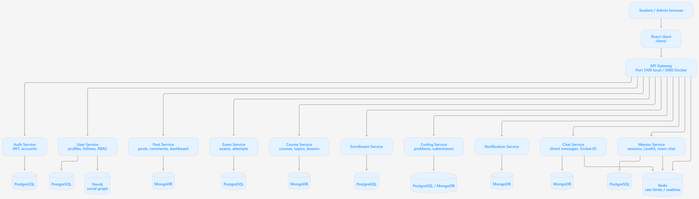
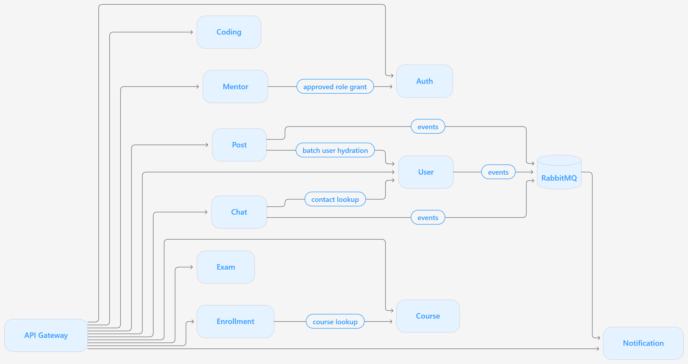
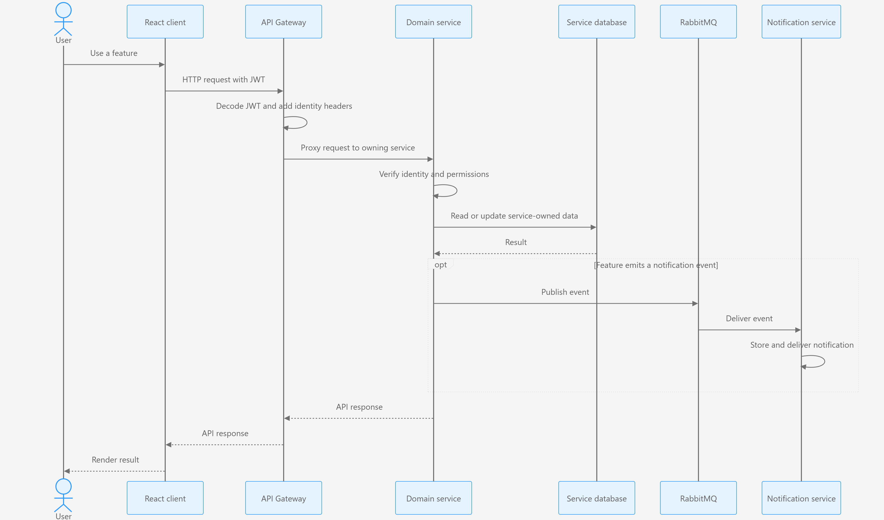
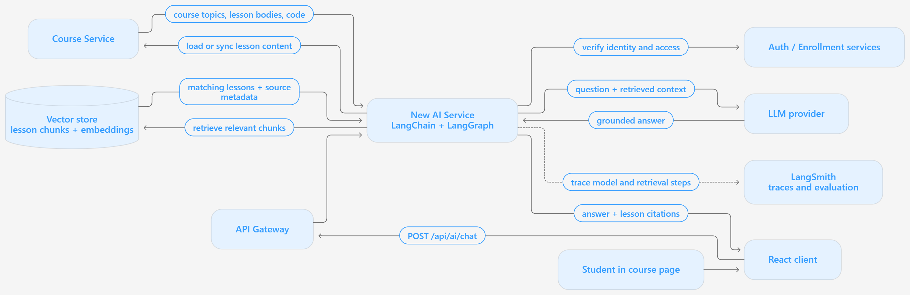
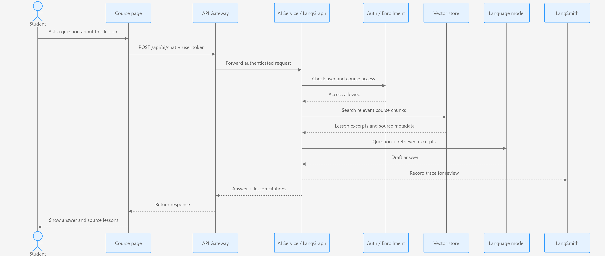
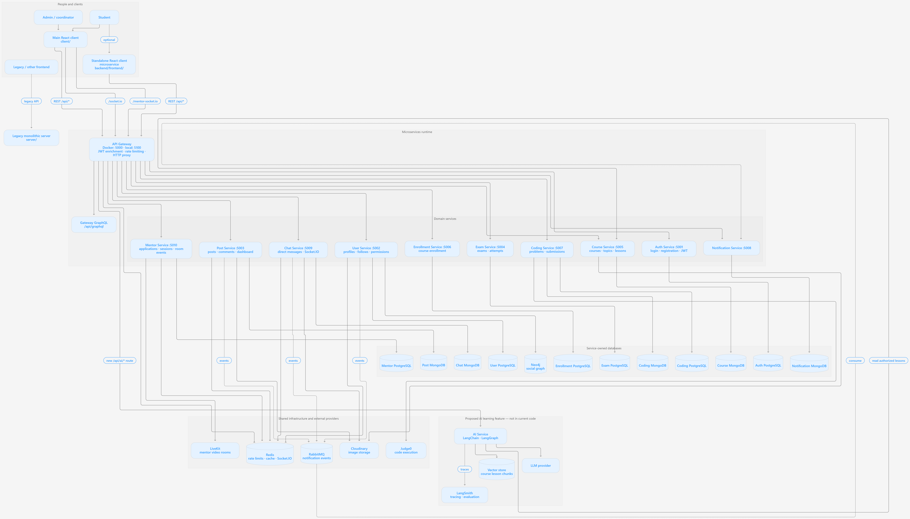

# Code Campus

Code Campus is a social learning platform built around a React client and a
microservices backend. It brings together student profiles and social
connections, a community feed, courses and enrollments, exams, coding practice,
notifications, direct messages, and live mentor sessions.

This repository contains the main web client, a second frontend for the
microservices platform, the API gateway and domain services, deployment
manifests, and architecture diagrams. The diagrams below are stored in the
[`diagrams/`](diagrams/) folder. Click any diagram to open its full-size image.

## Architecture overview

The browser clients send REST and GraphQL requests through the API Gateway.
The gateway routes each request to the service that owns the feature and its
data. Services communicate where needed through internal HTTP calls and
RabbitMQ events; Socket.IO and Redis support realtime messaging and mentor
sessions.

<p align="center">
  <a href="diagrams/mermaid-diagram.png">
    
  </a>
</p>
<p align="center"><em>High-level view of the clients, gateway, domain services, service-owned databases, shared infrastructure, and external providers. The AI learning area is a proposed extension, not a currently listed backend service.</em></p>

### Cross-service request and event flow

<p align="center">
  <a href="diagrams/service_interaction.png">
    
  </a>
</p>
<p align="center"><em>Shows representative service interactions, including mentor role approval, post and chat user lookups, course lookups, and notification events.</em></p>

<p align="center">
  <a href="diagrams/mermaid-diagram3.png">
    
  </a>
</p>
<p align="center"><em>Illustrates the authenticated request path through the gateway to a domain service and database, with optional RabbitMQ notification delivery.</em></p>

## Microservices

| Component | Local port | Main responsibilities | Versioned API |
|---|---:|---|---|
| API Gateway | `5100` (Docker: `5000`) | REST proxy, GraphQL aggregation, CORS, rate limiting, WebSocket proxying | `/v1/*`, `/v1/graphql` |
| Auth Service | `5001` | Registration, login, access tokens, refresh sessions, account profile operations | `/v1/auth/*` |
| User Service | `5002` | Profiles, directory, social graph, follow relationships, RBAC | `/v1/users/*`, `/v1/social/*`, `/v1/admin/rbac/*` |
| Post Service | `5003` | Posts, comments, feed, admin post tools, dashboard data | `/v1/posts/*`, `/v1/admin/posts/*` |
| Exam Service | `5004` | Exam authoring, attempts, scoring, analytics | `/v1/exams/*`, `/v1/attempts/*`, `/v1/admin/exams/*` |
| Course Service | `5005` | Courses, topics, subtopics and lesson content | `/v1/courses/*` |
| Enrollment Service | `5006` | Course enrollment, progress and certificates | `/v1/enrollments/*` |
| Coding Service | `5007` | Coding problems, execution, submissions and analytics | `/v1/coding/*` |
| Notification Service | `5008` | Notification persistence, read state and event handling | `/v1/notifications/*` |
| Chat Service | `5009` | Direct messages, conversation history and Socket.IO | `/v1/messages/*`, `/socket.io` |
| Mentor Service | `5010` | Mentor applications, approval, sessions, room chat, polls and LiveKit tokens | `/v1/mentor/*`, `/mentor-socket.io` |

REST responses from versioned gateway routes include the `API-Version: 1`
header. The old `/api/*` REST and `/api/graphql` paths are retained as
compatibility aliases during client migration. Health endpoints and WebSocket
paths are intentionally unversioned. See the
[microservices documentation](microservice%20backend/README.md) and
[authentication token flow](microservice%20backend/AUTH_TOKEN_FLOW.md) for
details.

## Service diagrams

Each service image is linked to the corresponding full-resolution file in
[`diagrams/`](diagrams/).

### API Gateway

Routes REST requests to the owning service, hosts GraphQL aggregation, applies
gateway policies, and proxies chat and mentor WebSocket connections.

<p align="center"><a href="diagrams/API%20Gateway.png"></a></p>

### Auth Service

Shows account registration and login, token issuance, protected account
operations, profile-image storage, and the internal approved-mentor role flow.

<p align="center"><a href="diagrams/Auth%20Service.png"></a></p>

### User Service

Covers profile and RBAC routes, follow operations, SQL-backed relationship
storage, Neo4j graph traversal and recommendations, caching, and notification
events.

<p align="center"><a href="diagrams/User%20Service.png"></a></p>

### Post Service

Shows post and feed operations, media uploads, notification events, and author
hydration through User Service with cached user data.

<p align="center"><a href="diagrams/Post%20Service.png"></a></p>

### Exam Service

Describes exam authoring and analytics alongside attempt submission, answer
evaluation, JWT/permission checks, and persisted results.

<p align="center"><a href="diagrams/Exam%20Service.png"></a></p>

### Course Service

Shows course and lesson content management, nested topics and subtopics, image
uploads, and course-permission checks.

<p align="center"><a href="diagrams/Course%20Service.png"></a></p>

### Enrollment Service

Covers enrollment, course lookups, progress updates, certificate generation or
retrieval, and enrollment database operations.

<p align="center"><a href="diagrams/Enrollment%20Service.png"></a></p>

### Coding Service

Shows problem management, sample-test runs, solution submissions, execution
provider integration, persisted submissions, and analytics.

<p align="center"><a href="diagrams/Coding%20Service.png"></a></p>

### Notification Service

Illustrates authenticated notification APIs and the event-consumer path from
RabbitMQ to stored notifications and realtime delivery.

<p align="center"><a href="diagrams/Notification%20Service.png"></a></p>

### Chat Service

Shows conversation and message routes, contact lookups from User Service,
MongoDB message storage, image uploads, notification events, and Socket.IO
delivery with Redis support.

<p align="center"><a href="diagrams/Chat%20Service.png"></a></p>

Detailed implementation diagrams:

<p align="center"><a href="diagrams/Chat%20Messaging%20Service%20-%20Detailed%20Flow.png"></a></p>

<p align="center"><a href="diagrams/Chat%20Realtime%20Calling%20-%20Detailed%20Flow.png"></a></p>

Reference-style flowcharts:

<p align="center"><a href="diagrams/Chat%20Messaging%20Service%20-%20Flowchart.png"></a></p>

<p align="center"><a href="diagrams/Chat%20Realtime%20Calling%20-%20Flowchart.png"></a></p>

### OAuth social login flow

<p align="center"><a href="diagrams/OAuth%20Social%20Login%20Flow.png"></a></p>

### Mentor Service

Covers mentor applications and admin review, role approval through Auth
Service, session enrollment and join tokens, LiveKit, PostgreSQL, and realtime
room events.

<p align="center"><a href="diagrams/Mentor%20Service.png"></a></p>

## Proposed AI learning diagrams

The following diagrams describe a possible course-grounded AI tutor flow using
retrieved lesson content, an LLM provider, and LangSmith tracing. They are
design references only; the current API/service registry above does not list
an AI service.

<p align="center">
  <a href="diagrams/mermaid-diagram1.png">
    
  </a>
</p>
<p align="center"><em>Proposed AI service architecture: lesson retrieval, access checks, grounded answers, citations, and optional tracing.</em></p>

<p align="center">
  <a href="diagrams/mermaid-diagram2.png">
    
  </a>
</p>
<p align="center"><em>Proposed question-answer sequence from a course page through the gateway, retrieval, access verification, and language model.</em></p>

<p align="center">
  <a href="diagrams/mermaid-diagram4.png">
    
  </a>
</p>
<p align="center"><em>Expanded platform map. Its AI learning section is marked as proposed and should not be read as a deployed service.</em></p>

## Repository structure

```text
.
├── client/                     # Main React/Vite application
├── diagrams/                   # Platform, service, and proposed-flow diagrams
├── k8s/                        # Kubernetes deployment/service/ingress manifests
├── microservice backend/
│   ├── api-gateway/
│   ├── auth-service/
│   ├── chat-service/
│   ├── coding-service/
│   ├── course-service/
│   ├── enrollment-service/
│   ├── exam-service/
│   ├── frontend/               # Separate React/Tailwind microservices client
│   ├── mentor-service/
│   ├── notification-service/
│   ├── post-service/
│   ├── shared/
│   ├── user-service/
│   ├── docker-compose.yml
│   └── README.md               # Backend setup, environment and service details
├── mentor-service-architecture.svg
└── README.md
```

## Getting started

### Run the complete backend with Docker Compose

Docker Compose starts the gateway, domain services, and configured data and
messaging infrastructure. Configure secrets and external provider settings
before exposing the stack beyond local development.

```powershell
cd "microservice backend"
Copy-Item .env.example .env
# Edit .env and set required secrets and service configuration.
docker-compose up --build
```

The Docker gateway is exposed on port `5000`. Stop the stack with:

```powershell
docker-compose down
```

### Run backend services locally

Configure the services' databases, broker, Redis, JWT secret, and any external
providers in `microservice backend/.env`, then install and start the services:

```powershell
cd "microservice backend"
npm.cmd run install:all
npm.cmd run dev
```

`npm run dev` starts the gateway and the ten domain services. For local service
ports, environment setup, demo data, and individual service commands, see the
[microservices README](microservice%20backend/README.md).

### Run the main frontend

In another terminal, configure the gateway URL in `client/.env` if needed.
`client/.env.example` provides a local `/v1` example.

```powershell
cd client
npm.cmd install
npm.cmd run dev
```

### Run the standalone microservices frontend

This is a separate React + Tailwind client for the microservices backend.

```powershell
cd "microservice backend\frontend"
npm.cmd install
npm.cmd run dev
```

Its development server normally runs at `http://localhost:5173` and proxies API
requests to the gateway at `http://localhost:5100`.

## API and realtime endpoints

- REST integrations should use `/v1/*`.
- GraphQL is available at `POST /v1/graphql`.
- `/health` is the gateway health endpoint; each service also exposes its own
  health endpoint on its service port.
- `/socket.io` serves chat realtime connections.
- `/mentor-socket.io` serves mentor-room realtime connections.
- Legacy `/api/*` and `/api/graphql` routes are compatibility aliases during
  migration.

## Security and deployment notes

- Set a strong `JWT_SECRET` consistently for the gateway and token-validating
  services. Configure exact trusted browser origins in `CLIENT_ORIGINS`.
- Never commit `.env` secrets or expose provider secrets in frontend variables.
- Use HTTPS/WSS in production and configure secure refresh-cookie settings for
  cross-site frontend/API deployments.
- Keep databases and internal service endpoints private; expose the API
  Gateway, not individual service ports, to public clients.
- The manifests in `k8s/` contain placeholder images and an older `/api`
  ingress path. Review and update image names, secrets, networking, and routing
  for the current `/v1` gateway before using them to deploy this microservices
  stack.

For the full backend deployment and token lifecycle guidance, see
[microservice backend/README.md](microservice%20backend/README.md) and
[AUTH_TOKEN_FLOW.md](microservice%20backend/AUTH_TOKEN_FLOW.md).

## Deploying on Render

This repository does not include a Render Blueprint. Create the services
individually from the same Git repository. Deploy PostgreSQL, MongoDB, Redis,
and RabbitMQ first. Render does not provide managed MongoDB or RabbitMQ, so
use compatible external providers. The User Service graph database can use
Neo4j Aura or another externally hosted Neo4j provider.

### Create the Render services

Create the gateway as a **Web Service**, and create the domain services as
**Private Services** so clients reach them only through the gateway. Use the
listed Root Directory, Build Command `npm install`, and Start Command
`npm start`. Render sets `PORT` automatically; do not hard-code a port in
service settings. If your Render plan does not include Private Services, the
domain services will need to be public Web Services; do not rely on CORS alone
to protect them.

The gateway defaults to local service URLs for local development. In Render,
the gateway detects Render's `RENDER=true` environment variable and requires
each standard `*_SERVICE_URL` variable below to point to a deployed service.
You can also set `APP_ENV=production` explicitly. Never use `localhost` for a
deployed service URL. Older mixed-case URL names in local `.env` files are
supported only as a migration fallback; use the standard uppercase variable
names in Render. The current mixed-case `User_Service` entry points to an
invalid Post Service host; the gateway intentionally ignores it. Set the
verified User Service URL as `USER_SERVICE_URL` in Render.

In production, the gateway waits up to 80 seconds for the requested downstream
service's `/health` endpoint before forwarding an API request. It keeps its own
`/health` endpoint available for Render and reports downstream readiness in
`readyServices` and `allServicesReady`. If a service is still unavailable,
the request receives `503` with `Retry-After: 30`.

| Render service | Type | Root Directory | Health Check Path |
|---|---|---|---|
| `cc-api-gateway` | Web Service | `microservice backend/api-gateway` | `/health` |
| `cc-auth` | Private Service | `microservice backend/auth-service` | `/health` |
| `cc-user` | Private Service | `microservice backend/user-service` | `/health` |
| `cc-post` | Private Service | `microservice backend/post-service` | `/health` |
| `cc-exam` | Private Service | `microservice backend/exam-service` | `/health` |
| `cc-course` | Private Service | `microservice backend/course-service` | `/health` |
| `cc-enrollment` | Private Service | `microservice backend/enrollment-service` | `/health` |
| `cc-coding` | Private Service | `microservice backend/coding-service` | `/health` |
| `cc-notification` | Private Service | `microservice backend/notification-service` | `/health` |
| `cc-chat` | Private Service | `microservice backend/chat-service` | `/health` |
| `cc-mentor` | Private Service | `microservice backend/mentor-service` | `/health` |

Create the `client` as a **Static Site** with Build Command `npm install &&
npm run build`, Publish Directory `dist`, and Root Directory `client`. Set
`VITE_API_URL` to `https://<gateway-public-host>/v1` and
`VITE_SOCKET_URL` to `https://<gateway-public-host>`. These are build-time
variables, so redeploy the Static Site after changing them. Add a rewrite rule
from `/*` to `/index.html` so direct navigation and refreshes on React routes
work.

For Vercel, set the Project Root Directory to `client`, Build Command to
`npm run build`, and Output Directory to `dist`. The checked-in
[`client/vercel.json`](client/vercel.json) also declares `dist` and the SPA
route fallback, so it avoids Vercel looking for Create React App's `build`
directory. Set the Vercel production environment variable `VITE_API_URL` to
the public Render API Gateway URL ending in `/v1` (for example,
`https://<gateway-public-host>/v1`) and `VITE_SOCKET_URL` to the gateway origin.
Never set these to `localhost`. The Vercel build now fails with a clear message
if `VITE_API_URL` is missing or points to localhost.

The optional Python AI service is a **Web Service** with Root Directory
`ai-service`, Runtime **Docker**, and Dockerfile Path `./Dockerfile`. It honors
Render's `PORT`. If it uses Chroma's local store, attach a persistent disk at
`/app/chroma_db` and set `CHROMA_PERSIST_DIR=/app/chroma_db`; otherwise its
index is lost when the service restarts. Prefer a **Private Service** for AI if
the Render plan supports it.

### Configure environment variables

Use Render's private service addresses for internal calls, and keep only the
gateway and frontend public. Add these gateway variables, using the matching
internal URLs shown in each Render service:

- `AUTH_SERVICE_URL`, `USER_SERVICE_URL`, `POST_SERVICE_URL`,
  `EXAM_SERVICE_URL`, `COURSE_SERVICE_URL`, `ENROLLMENT_SERVICE_URL`,
  `CODING_SERVICE_URL`, `NOTIFICATION_SERVICE_URL`, `CHAT_SERVICE_URL`,
  `MENTOR_SERVICE_URL`, and `AI_SERVICE_URL`. The gateway requires all of
  these URLs at startup in production because it registers routes for every
  service.
- `CLIENT_ORIGINS` set to the exact Static Site origin (no trailing slash).
- `JWT_SECRET` set to the same random secret in the gateway and every service
  that validates JWTs. Keep it at least 64 characters.
- The gateway and Auth service trust one proxy hop automatically on Render.
  Set `TRUST_PROXY=true` only when running behind a trusted reverse proxy
  outside Render.
- `REDIS_URL` for the gateway and the services that use Redis. Mentor requires
  it when `NODE_ENV=production`; set `NODE_ENV=production` on Mentor.
- Set service-to-service URLs where used: `USER_SERVICE_URL` on Auth, Post,
  and Chat, `COURSE_SERVICE_URL` on Enrollment, `AUTH_SERVICE_URL` on Mentor,
  and `CHAT_SERVICE_URL` on Notification. Use the private addresses from Render.

Configure each database with its own service-specific connection string:

- PostgreSQL: `AUTH_DATABASE_URL`, `USER_SHARD_0_DATABASE_URL`,
  `USER_SHARD_1_DATABASE_URL` (and temporary legacy `USER_DATABASE_URL` only
  when migrating existing user profiles),
  `EXAM_DATABASE_URL`, `ENROLLMENT_DATABASE_URL`, `CODING_DATABASE_URL`, and
  `MENTOR_DATABASE_URL`.
- The Auth password-reset command reads `AUTH_DATABASE_URL_UNPOOLED` first when
  set, otherwise `AUTH_DATABASE_URL`, from `microservice backend/.env`. It
  rejects localhost targets and prints the destination host/database before
  prompting. Keep database URLs out of source control.
- MongoDB: `POST_MONGO_URI`, `COURSE_MONGO_URI`, `CODING_MONGO_URI`,
  `CHAT_MONGO_URI`, and `NOTIFICATION_MONGO_URI`.
- User Service graph storage on the `cc-user` service: `NEO4J_URI`,
  `NEO4J_USER`, `NEO4J_PASSWORD`, and `NEO4J_DATABASE`. In Render, open
  **cc-user → Environment** and add these values there. Do not add them to the
  gateway or frontend. `NEO4J_USER` is the Neo4j driver variable name for the
  Aura username.
- Event delivery: `RABBITMQ_URL` on the producer and notification services.

Also set `INTERNAL_SERVICE_TOKEN` consistently for Auth, User, Mentor, Chat,
Notification, and AI if deployed,
`CLIENT_URL` and `PUBLIC_API_URL` for Auth, and
`REFRESH_COOKIE_SAME_SITE=none`, `REFRESH_COOKIE_SECURE=true`, and
those providers. Add OAuth callback URLs only if using those providers. Never
put database credentials, JWT secrets, or provider secrets in `VITE_*`
variables.

If deploying the AI service, configure its required `OPENAI_API_KEY` and
`JWT_SECRET`, database URLs, `USER_SERVICE_URL`, `ENROLLMENT_SERVICE_URL`,
`EXAM_SERVICE_URL`, `CODING_SERVICE_URL`, `INTERNAL_SERVICE_TOKEN`, and
`CLIENT_ORIGINS` as appropriate. The AI service's outbound URLs must be the
private addresses of those backend services, not `localhost`.

### After deployment

1. Deploy databases and broker first, then the domain services, AI service if
   needed, and the API Gateway after its downstream URLs are available.
2. Deploy the Static Site with the gateway's public URL, then set the exact
   frontend origin in `CLIENT_ORIGINS` on the gateway, Auth, Mentor, and AI
   services. Update OAuth provider redirect URLs to the deployed Auth callback
   URLs.
3. Open each service's `/health` endpoint and the gateway's `/health`. The
   gateway should report the correct internal service URLs. Check Render logs
   for database/authentication failures before testing the UI.
4. Test signup, login and refresh after correcting browser CORS errors if any;
   then test posts, courses, notifications, and both chat and mentor
   WebSockets. The API Gateway proxies `/socket.io` and `/mentor-socket.io`.

## Maintainer

Malay Maity
