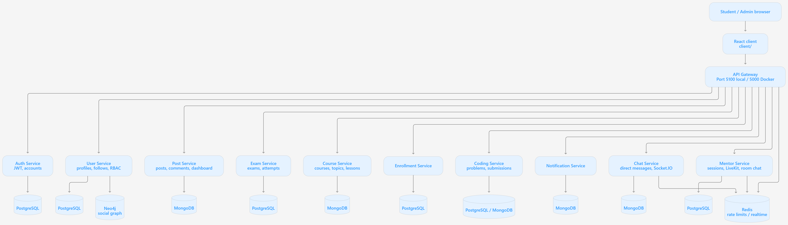
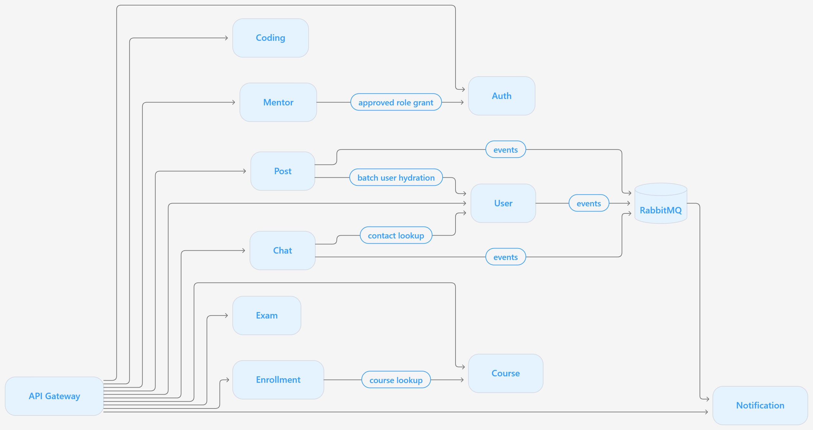
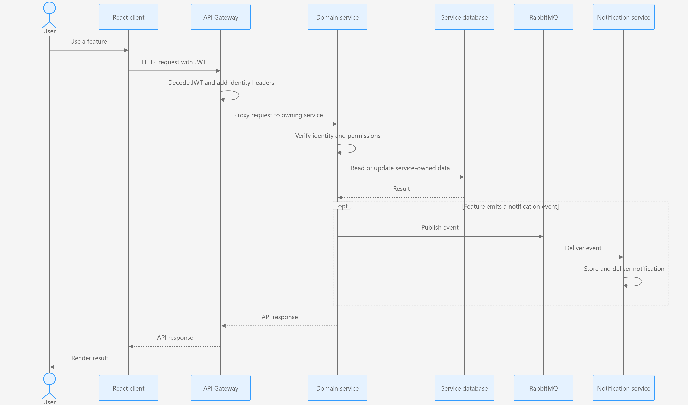
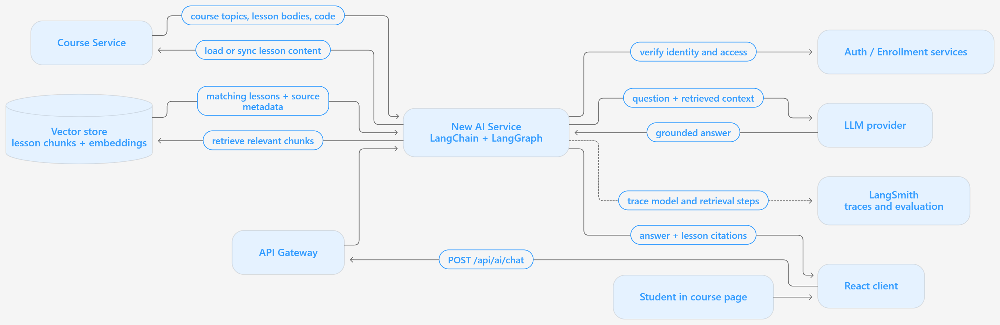
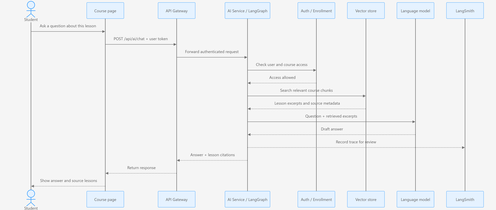
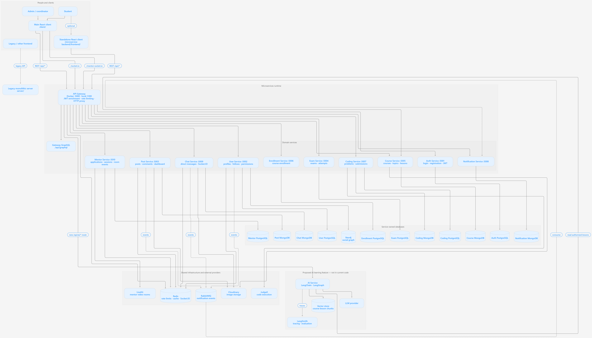

# Code Campus

Code Campus is a social learning platform built around a React client and a
microservices backend. It brings together student profiles and social
connections, a community feed, courses and enrollments, exams, coding practice,
notifications, direct messages, and live mentor sessions.

This repository contains the main web client, a second frontend for the
microservices platform, the API gateway and domain services, deployment
manifests, and architecture diagrams. The diagrams below are stored in the
[`diagrams/`](diagrams/) folder. Click any diagram to open its full-size image.

## Architecture overview

The browser clients send REST and GraphQL requests through the API Gateway.
The gateway routes each request to the service that owns the feature and its
data. Services communicate where needed through internal HTTP calls and
RabbitMQ events; Socket.IO and Redis support realtime messaging and mentor
sessions.

<p align="center">
  <a href="diagrams/mermaid-diagram.png">
    
  </a>
</p>
<p align="center"><em>High-level view of the clients, gateway, domain services, service-owned databases, shared infrastructure, and external providers. The AI learning area is a proposed extension, not a currently listed backend service.</em></p>

### Cross-service request and event flow

<p align="center">
  <a href="diagrams/service_interaction.png">
    
  </a>
</p>
<p align="center"><em>Shows representative service interactions, including mentor role approval, post and chat user lookups, course lookups, and notification events.</em></p>

<p align="center">
  <a href="diagrams/mermaid-diagram3.png">
    
  </a>
</p>
<p align="center"><em>Illustrates the authenticated request path through the gateway to a domain service and database, with optional RabbitMQ notification delivery.</em></p>

## Microservices

| Component | Local port | Main responsibilities | Versioned API |
|---|---:|---|---|
| API Gateway | `5100` (Docker: `5000`) | REST proxy, GraphQL aggregation, CORS, rate limiting, WebSocket proxying | `/v1/*`, `/v1/graphql` |
| Auth Service | `5001` | Registration, login, access tokens, refresh sessions, account profile operations | `/v1/auth/*` |
| User Service | `5002` | Profiles, directory, social graph, follow relationships, RBAC | `/v1/users/*`, `/v1/social/*`, `/v1/admin/rbac/*` |
| Post Service | `5003` | Posts, comments, feed, admin post tools, dashboard data | `/v1/posts/*`, `/v1/admin/posts/*` |
| Exam Service | `5004` | Exam authoring, attempts, scoring, analytics | `/v1/exams/*`, `/v1/attempts/*`, `/v1/admin/exams/*` |
| Course Service | `5005` | Courses, topics, subtopics and lesson content | `/v1/courses/*` |
| Enrollment Service | `5006` | Course enrollment, progress and certificates | `/v1/enrollments/*` |
| Coding Service | `5007` | Coding problems, execution, submissions and analytics | `/v1/coding/*` |
| Notification Service | `5008` | Notification persistence, read state and event handling | `/v1/notifications/*` |
| Chat Service | `5009` | Direct messages, conversation history and Socket.IO | `/v1/messages/*`, `/socket.io` |
| Mentor Service | `5010` | Mentor applications, approval, sessions, room chat, polls and LiveKit tokens | `/v1/mentor/*`, `/mentor-socket.io` |

REST responses from versioned gateway routes include the `API-Version: 1`
header. The old `/api/*` REST and `/api/graphql` paths are retained as
compatibility aliases during client migration. Health endpoints and WebSocket
paths are intentionally unversioned. See the
[microservices documentation](microservice%20backend/README.md) and
[authentication token flow](microservice%20backend/AUTH_TOKEN_FLOW.md) for
details.

## Service diagrams

Each service image is linked to the corresponding full-resolution file in
[`diagrams/`](diagrams/).

### API Gateway

Routes REST requests to the owning service, hosts GraphQL aggregation, applies
gateway policies, and proxies chat and mentor WebSocket connections.

<p align="center"><a href="diagrams/API%20Gateway.png"></a></p>

### Auth Service

Shows account registration and login, token issuance, protected account
operations, profile-image storage, and the internal approved-mentor role flow.

<p align="center"><a href="diagrams/Auth%20Service.png"></a></p>

### User Service

Covers profile and RBAC routes, follow operations, SQL-backed relationship
storage, Neo4j graph traversal and recommendations, caching, and notification
events.

<p align="center"><a href="diagrams/User%20Service.png"></a></p>

### Post Service

Shows post and feed operations, media uploads, notification events, and author
hydration through User Service with cached user data.

<p align="center"><a href="diagrams/Post%20Service.png"></a></p>

### Exam Service

Describes exam authoring and analytics alongside attempt submission, answer
evaluation, JWT/permission checks, and persisted results.

<p align="center"><a href="diagrams/Exam%20Service.png"></a></p>

### Course Service

Shows course and lesson content management, nested topics and subtopics, image
uploads, and course-permission checks.

<p align="center"><a href="diagrams/Course%20Service.png"></a></p>

### Enrollment Service

Covers enrollment, course lookups, progress updates, certificate generation or
retrieval, and enrollment database operations.

<p align="center"><a href="diagrams/Enrollment%20Service.png"></a></p>

### Coding Service

Shows problem management, sample-test runs, solution submissions, execution
provider integration, persisted submissions, and analytics.

<p align="center"><a href="diagrams/Coding%20Service.png"></a></p>

### Notification Service

Illustrates authenticated notification APIs and the event-consumer path from
RabbitMQ to stored notifications and realtime delivery.

<p align="center"><a href="diagrams/Notification%20Service.png"></a></p>

### Chat Service

Shows conversation and message routes, contact lookups from User Service,
MongoDB message storage, image uploads, notification events, and Socket.IO
delivery with Redis support.

<p align="center"><a href="diagrams/Chat%20Service.png"></a></p>

Detailed implementation diagrams:

<p align="center"><a href="diagrams/Chat%20Messaging%20Service%20-%20Detailed%20Flow.png"></a></p>

<p align="center"><a href="diagrams/Chat%20Realtime%20Calling%20-%20Detailed%20Flow.png"></a></p>

Reference-style flowcharts:

<p align="center"><a href="diagrams/Chat%20Messaging%20Service%20-%20Flowchart.png"></a></p>

<p align="center"><a href="diagrams/Chat%20Realtime%20Calling%20-%20Flowchart.png"></a></p>

### Mentor Service

Covers mentor applications and admin review, role approval through Auth
Service, session enrollment and join tokens, LiveKit, PostgreSQL, and realtime
room events.

<p align="center"><a href="diagrams/Mentor%20Service.png"></a></p>

## Proposed AI learning diagrams

The following diagrams describe a possible course-grounded AI tutor flow using
retrieved lesson content, an LLM provider, and LangSmith tracing. They are
design references only; the current API/service registry above does not list
an AI service.

<p align="center">
  <a href="diagrams/mermaid-diagram1.png">
    
  </a>
</p>
<p align="center"><em>Proposed AI service architecture: lesson retrieval, access checks, grounded answers, citations, and optional tracing.</em></p>

<p align="center">
  <a href="diagrams/mermaid-diagram2.png">
    
  </a>
</p>
<p align="center"><em>Proposed question-answer sequence from a course page through the gateway, retrieval, access verification, and language model.</em></p>

<p align="center">
  <a href="diagrams/mermaid-diagram4.png">
    
  </a>
</p>
<p align="center"><em>Expanded platform map. Its AI learning section is marked as proposed and should not be read as a deployed service.</em></p>

## Repository structure

```text
.
├── client/                     # Main React/Vite application
├── diagrams/                   # Platform, service, and proposed-flow diagrams
├── k8s/                        # Kubernetes deployment/service/ingress manifests
├── microservice backend/
│   ├── api-gateway/
│   ├── auth-service/
│   ├── chat-service/
│   ├── coding-service/
│   ├── course-service/
│   ├── enrollment-service/
│   ├── exam-service/
│   ├── frontend/               # Separate React/Tailwind microservices client
│   ├── mentor-service/
│   ├── notification-service/
│   ├── post-service/
│   ├── shared/
│   ├── user-service/
│   ├── docker-compose.yml
│   └── README.md               # Backend setup, environment and service details
├── mentor-service-architecture.svg
└── README.md
```

## Getting started

### Run the complete backend with Docker Compose

Docker Compose starts the gateway, domain services, and configured data and
messaging infrastructure. Configure secrets and external provider settings
before exposing the stack beyond local development.

```powershell
cd "microservice backend"
Copy-Item .env.example .env
# Edit .env and set required secrets and service configuration.
docker-compose up --build
```

The Docker gateway is exposed on port `5000`. Stop the stack with:

```powershell
docker-compose down
```

### Run backend services locally

Configure the services' databases, broker, Redis, JWT secret, and any external
providers in `microservice backend/.env`, then install and start the services:

```powershell
cd "microservice backend"
npm.cmd run install:all
npm.cmd run dev
```

`npm run dev` starts the gateway and the ten domain services. For local service
ports, environment setup, demo data, and individual service commands, see the
[microservices README](microservice%20backend/README.md).

### Run the main frontend

In another terminal, configure the gateway URL in `client/.env` if needed.
`client/.env.example` provides a local `/v1` example.

```powershell
cd client
npm.cmd install
npm.cmd run dev
```

### Run the standalone microservices frontend

This is a separate React + Tailwind client for the microservices backend.

```powershell
cd "microservice backend\frontend"
npm.cmd install
npm.cmd run dev
```

Its development server normally runs at `http://localhost:5173` and proxies API
requests to the gateway at `http://localhost:5100`.

## API and realtime endpoints

- REST integrations should use `/v1/*`.
- GraphQL is available at `POST /v1/graphql`.
- `/health` is the gateway health endpoint; each service also exposes its own
  health endpoint on its service port.
- `/socket.io` serves chat realtime connections.
- `/mentor-socket.io` serves mentor-room realtime connections.
- Legacy `/api/*` and `/api/graphql` routes are compatibility aliases during
  migration.

## Security and deployment notes

- Set a strong `JWT_SECRET` consistently for the gateway and token-validating
  services. Configure exact trusted browser origins in `CLIENT_ORIGINS`.
- Never commit `.env` secrets or expose provider secrets in frontend variables.
- Use HTTPS/WSS in production and configure secure refresh-cookie settings for
  cross-site frontend/API deployments.
- Keep databases and internal service endpoints private; expose the API
  Gateway, not individual service ports, to public clients.
- The manifests in `k8s/` contain placeholder images and an older `/api`
  ingress path. Review and update image names, secrets, networking, and routing
  for the current `/v1` gateway before using them to deploy this microservices
  stack.

For the full backend deployment and token lifecycle guidance, see
[microservice backend/README.md](microservice%20backend/README.md) and
[AUTH_TOKEN_FLOW.md](microservice%20backend/AUTH_TOKEN_FLOW.md).

## Maintainer

Malay Maity
