# Enrollment Service — Complete Functional, Sharding, and Replication Flow

## 1. Full system overview

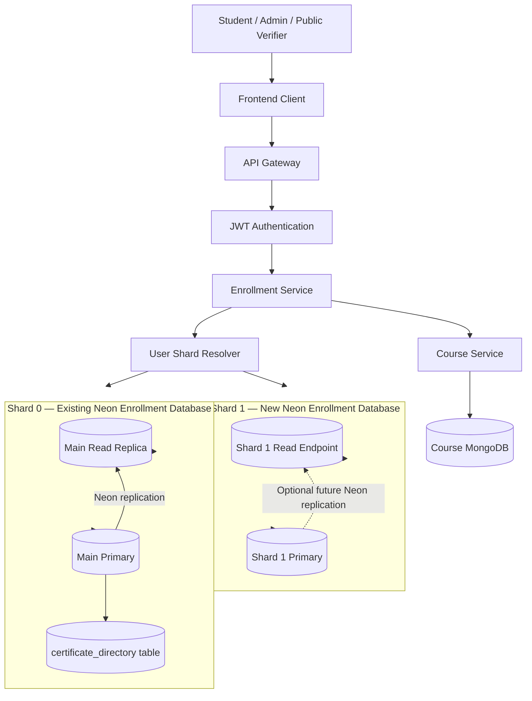

## 2. Request classification

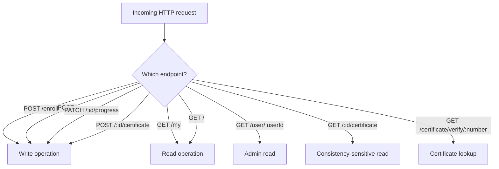

## 3. Authentication flow

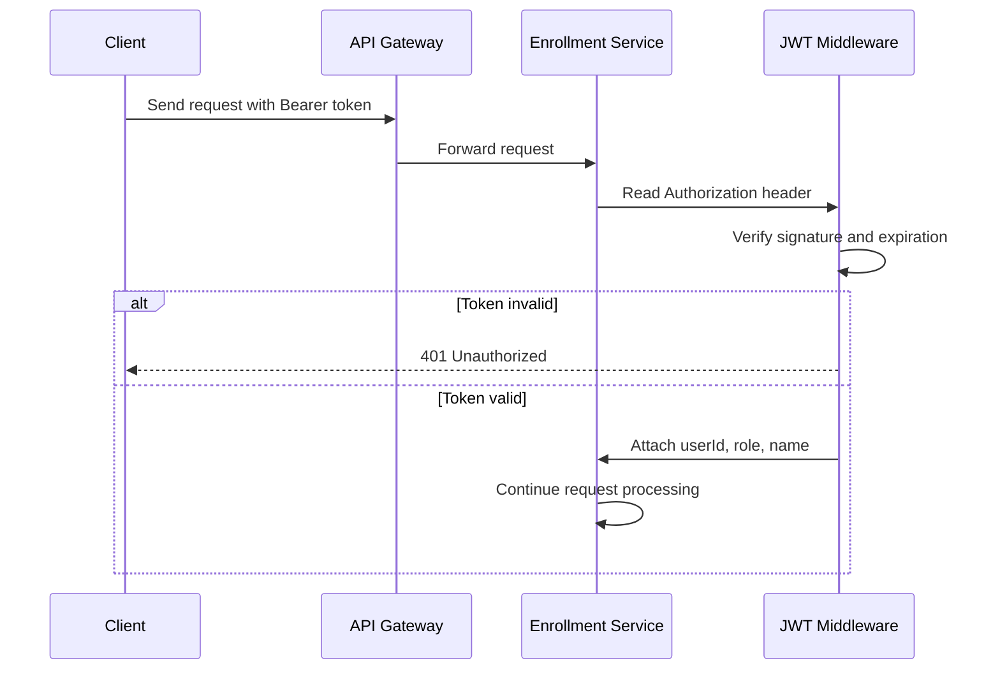

## 4. Shard selection procedure

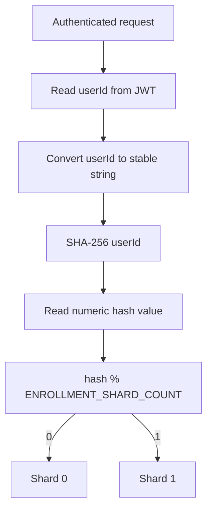

Example:

```text
userId = user-123
SHA-256(user-123) % 2 = 0
Destination = Shard 0
```

The same user always goes to the same shard while the shard count remains unchanged.

## 5. New enrollment flow

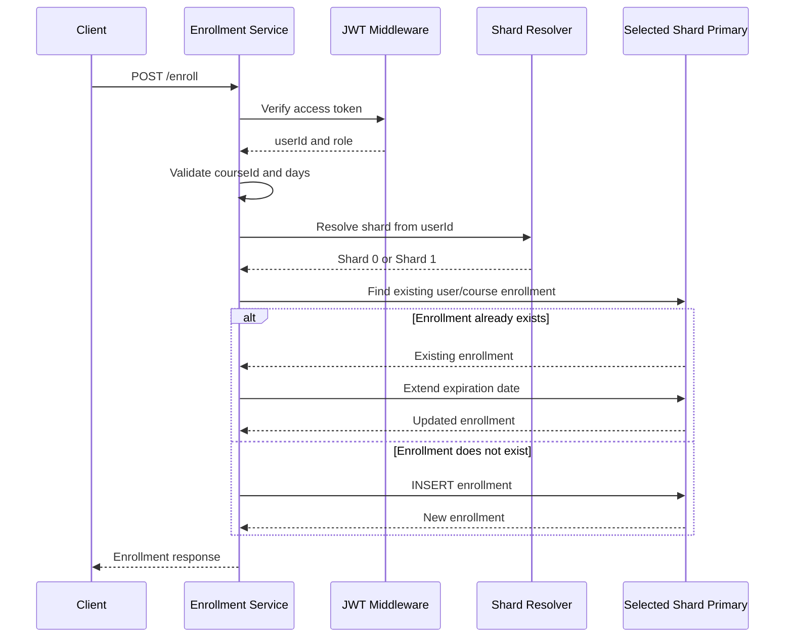

## 6. Get my enrollments

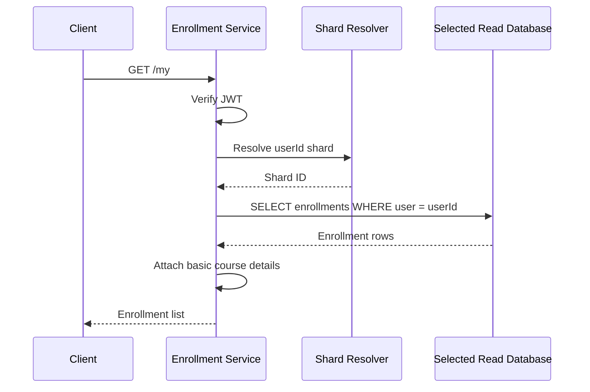

Current routing:

```text
Shard 0 → main read replica
Shard 1 → Shard 1 primary until a replica is provisioned
```

## 7. Admin get enrollments for a user

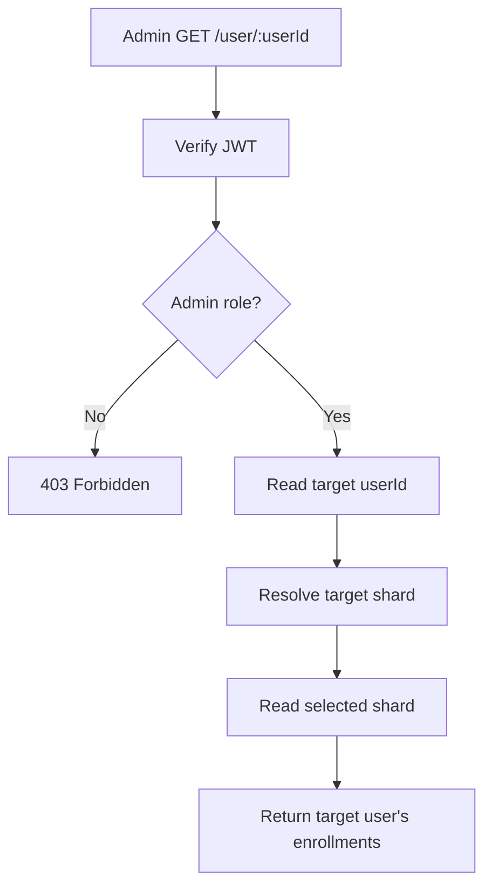

## 8. Progress update flow

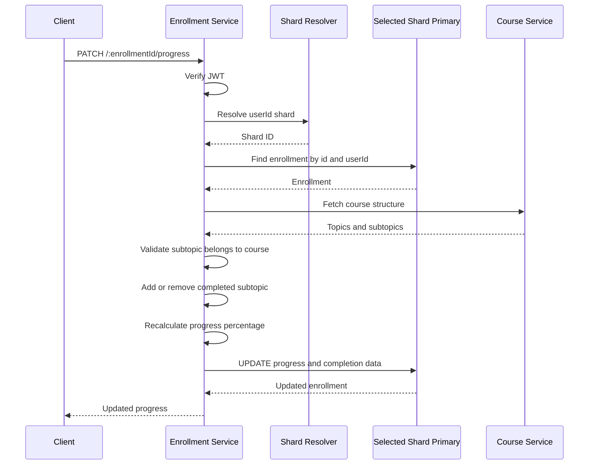

## 9. Certificate generation flow

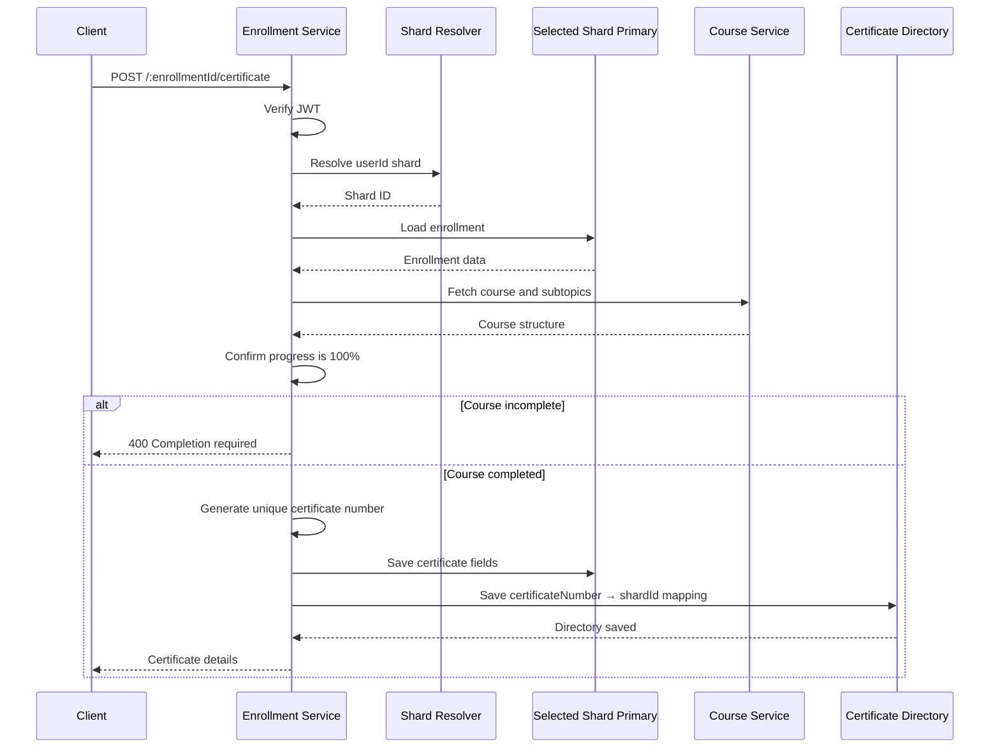

## 10. Certificate verification flow

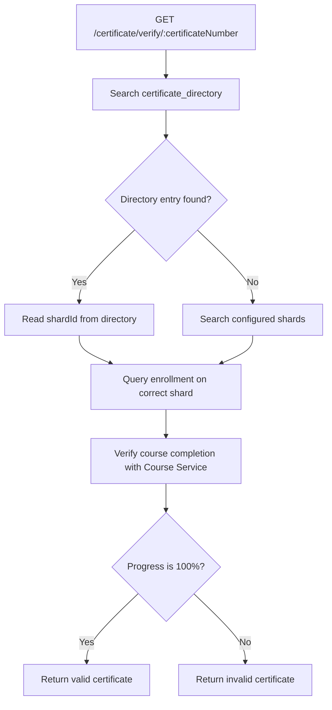

## 11. Replication flow

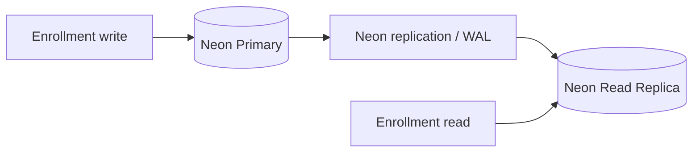

Replication rule:

```text
INSERT / UPDATE / DELETE → primary
Safe SELECT → read replica
Certificate and progress operations → primary
```

## 12. Read-after-write behavior

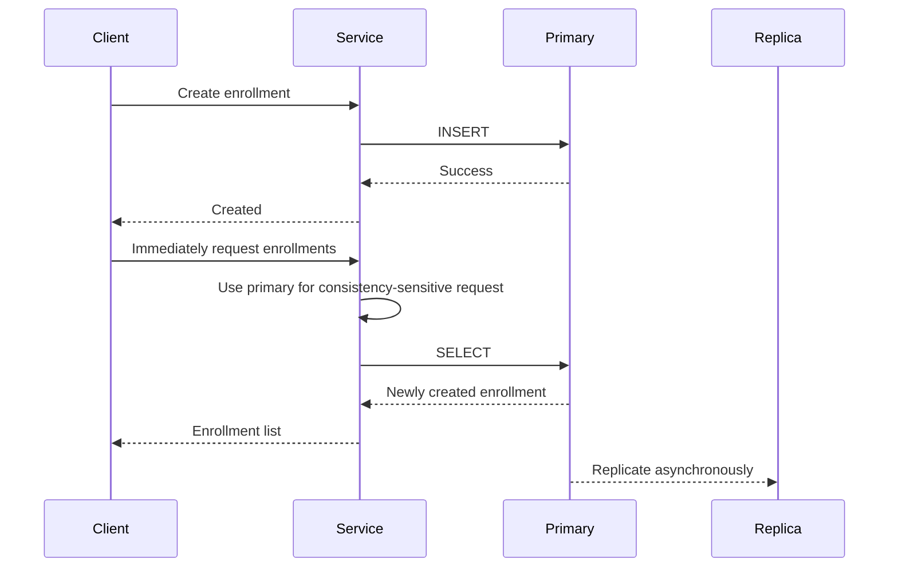

## 13. Database failure behavior

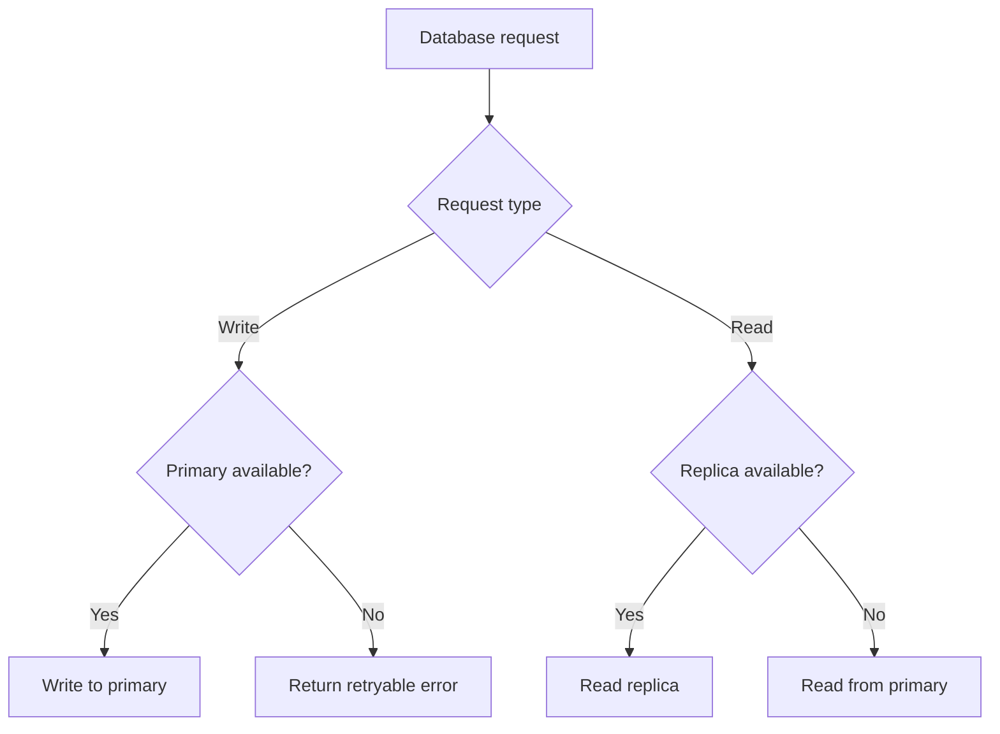

## 14. Existing data migration flow

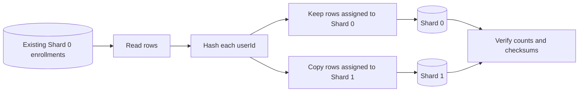

The backfill is idempotent and does not delete the original rows.

## 15. Startup procedure

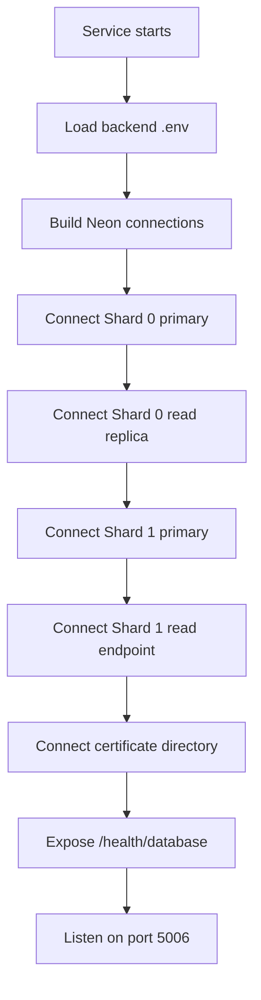

Example startup output:

```text
[Enrollment Service] Connected to main database
[Enrollment Service] Connected to read replica for main database
[Enrollment Service] Connected to sharding database 1
[Enrollment Service] Connected to certificate directory on Neon
[Enrollment Service] Neon PostgreSQL ready (2 shard(s))
[Enrollment Service] Running on port 5006
```

## 16. Environment mapping

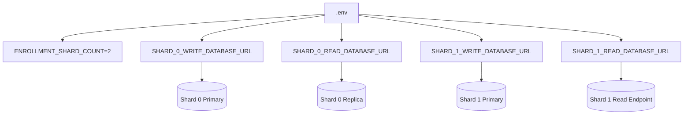

## 17. Final operational model

```text
User request
  ↓
JWT verification
  ↓
Extract userId
  ↓
SHA-256(userId) % 2
  ↓
Select Shard 0 or Shard 1
  ↓
Write to primary
  OR
Read from replica/read endpoint
  ↓
Return enrollment result
```

Current database count:

```text
Logical enrollment databases: 2
Neon endpoints: 3
Certificate directory: 1 table inside Shard 0
```
