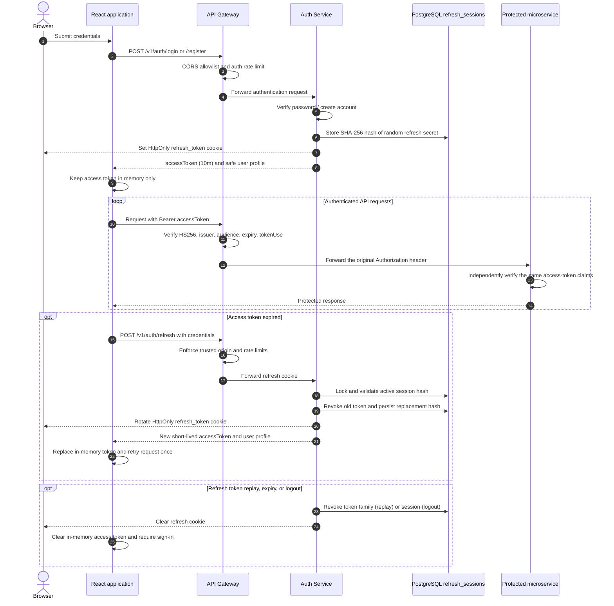

# Access and Refresh Token Flow

## Token boundaries

- Access JWTs are signed with HS256 and contain `iss=code-campus-auth`,
  `aud=code-campus-api`, a unique `jti`, `exp`, and `tokenUse=access`.
  `ACCESS_TOKEN_TTL` is restricted to 15 minutes or less.
- The browser never persists access tokens. Refresh secrets are random opaque
  values; only their SHA-256 hashes and session metadata are stored in SQL.
- Refresh tokens rotate on every successful refresh. Reusing a revoked token
  revokes its active family. Logout revokes the current refresh session;
  logout-all and password changes revoke all refresh sessions for that user.
- CORS allows only `CLIENT_ORIGINS`, with credentials enabled. Refresh and
  logout endpoints also validate the `Origin` header. API services verify
  bearer tokens themselves; identity headers supplied by callers are not trusted.
- Refresh calls are single-flight in each tab and use the Web Locks API where
  available to serialize rotation across tabs. Browsers without Web Locks still
  use in-tab single-flight refresh.
- New integrations should use `/v1/auth/*`. `/api/auth/*` remains available as
  a compatibility alias while services are migrated incrementally. The refresh
  cookie uses `Path=/` so sessions work with either prefix during the migration.

## Deployment checklist

1. Generate one secret with `node -e "console.log(require('crypto').randomBytes(48).toString('base64url'))"` and set the exact same `JWT_SECRET` on the gateway, auth service, and every service validating JWTs. Rotate any former shared secret; previously issued tokens will stop working.
2. Set exact frontend origins in `CLIENT_ORIGINS`. Do not use wildcard origins with credentialed cookies.
3. The Docker auth service runs in production mode and defaults to `SameSite=None; Secure`. Require HTTPS. For same-site development outside Docker, `lax` is appropriate.
4. Prefer serving the API and UI from the same site. Some browsers block third-party cookies even when `SameSite=None` is configured.
5. Keep auth and domain services private behind the gateway in production. The auth service has no published host port in Docker Compose. Configure proxy trust only when the service is behind a known proxy (`TRUST_PROXY=true`) on both the gateway and auth service.
6. The auth service creates the `refresh_sessions` table when absent without altering existing tables. Where startup DDL is prohibited, apply a reviewed schema migration before deployment.
